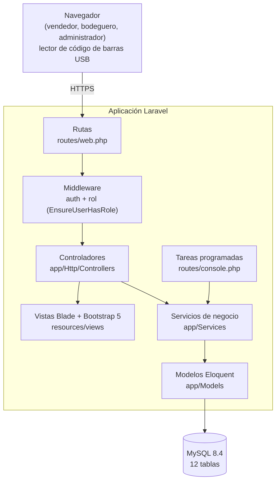
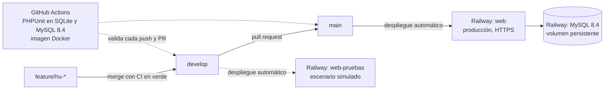

# Inventario El Portal

Sistema web de gestión de inventario y ventas para el **almacén El Portal** (Valle Grande, Lampa).
Proyecto de título de Ingeniería en Computación e Informática — Claudio Figueroa Arias, 2026.

**Estado:** `main` contiene el MPV completo (HU01–HU17, RF1–RF9) publicado en Railway: línea base LB-4 (`v1.0.0`) y su mantención `v1.0.1` (PHP 8.4), verificado con 164 pruebas unitarias y de integración en SQLite y MySQL 8.4. El siguiente hito es H5, la validación en ambiente de pruebas que reemplaza al piloto en el local (CC-05). El avance se registra en `docs/backlog.md` y en los [hitos de GitHub](https://github.com/claudio4ndres/inventario-el-portal/milestones).

## Alcance construido

| HU | Funcionalidad | Control |
|----|---------------|---------|
| HU01 | Inicio de sesión por rol (administrador, vendedor, bodeguero) | K8 |
| HU02 | Mantenedor de productos (código de barras, precio con IVA, punto de reorden, clase ABC) | K5 |
| HU03 | Recepción de mercadería con lote y fecha de vencimiento | K2 |
| HU04 | Venta con descuento automático de stock por lote (primero el que vence antes) | K1 |
| HU05 | Búsqueda por código de barras (lector USB) | K5 |
| HU06 | Alertas de productos en o bajo su punto de reorden | K3 |
| HU07 | Bitácora de movimientos (entradas y salidas con usuario y stock resultante) | K8 |
| HU08 | Gestión de usuarios y roles, con activación y desactivación | K8 |
| HU09 | Gestión de proveedores con RUT validado (módulo 11) | K2 |
| HU10 | Punto de reorden calculado con la demanda de 28 días | K3 |
| HU11 | Orden de compra sugerida y recepción contra OC | K3, K2 |
| HU12 | Alertas de lotes por vencer (FEFO) | K4 |
| HU13 | Registro de mermas con cantidad, costo y motivo | K7 |
| HU14 | Conteo cíclico por clase ABC, ajustes y exactitud del inventario | K6 |
| HU15 | Tablero de indicadores M1.1, M1.2, M2 y M3 con gráfico de quiebres por semana | K7 |
| HU16 | Importación del catálogo inicial desde CSV con vista previa de errores y plantilla descargable | K5 |
| HU17 | Clasificación ABC automática por valor vendido en 90 días (A 80 %, B 95 %, C el resto) | K6, K7 |

HU01–HU07 forman el prototipo (H2, `v0.1.0`); HU08–HU17 completan el MPV (H4, `v1.0.0`). La relación de cada HU con su requerimiento, causa, código y pruebas está en [`docs/trazabilidad.md`](docs/trazabilidad.md).

## Arquitectura

Aplicación web monolítica en **Laravel 13** (PHP 8.4) con el patrón modelo-vista-controlador y una capa de servicios para las reglas de negocio. Las pantallas se generan en el servidor con Blade y Bootstrap 5; no hay una API ni un frontend separado, lo que mantiene el sistema simple de operar para una microempresa.

### Capas



| Capa | Ubicación | Responsabilidad |
|------|-----------|-----------------|
| Rutas y acceso | `routes/web.php`, `app/Http/Middleware/EnsureUserHasRole.php` | Cada ruta exige sesión y el rol autorizado (control K8) |
| Controladores | `app/Http/Controllers` | Validan la solicitud y delegan en los servicios; no contienen reglas de negocio |
| Servicios | `app/Services` | Reglas de negocio (ver tabla siguiente) |
| Modelos | `app/Models` | Entidades Eloquent: `Producto`, `Lote`, `Venta`, `Movimiento`, `Conteo`, `OrdenCompra`… |
| Vistas | `resources/views` | Pantallas por módulo con Blade y Bootstrap 5 (CDN) |
| Datos | `database/migrations` | Modelo de 12 tablas versionado con migraciones ([`docs/modelo-datos.md`](docs/modelo-datos.md)) |

### Servicios de negocio

| Servicio | Qué resuelve | HU |
|----------|--------------|----|
| `InventarioService` | Toda operación que cambia el stock: recepción, venta FEFO, merma y ajustes de conteo, cada una en una transacción con bloqueo de filas | HU03, HU04, HU13, HU14 |
| `PuntoReordenService` | Punto de reorden = demanda diaria de 28 días × días de reposición + stock de seguridad | HU10 |
| `OrdenCompraService` | Cantidad sugerida (punto de reorden × 2 − stock) y órdenes por proveedor | HU11 |
| `ClasificacionAbcService` | Clases A, B y C por valor vendido en 90 días | HU17 |
| `IndicadorService` | Indicadores M1.1, M1.2, M2 y M3, calculados en cada consulta | HU15 |
| `CatalogoCsvService` | Lectura, validación e importación del catálogo desde CSV | HU16 |

### Decisiones de diseño

- **El stock no se guarda en el producto:** se calcula como la suma de los saldos de sus lotes. Así nunca queda desalineado con los lotes.
- **FEFO con transacción y bloqueo:** la venta toma los lotes con saldo ordenados por vencimiento y los bloquea (`lockForUpdate`); si falta stock en una línea, se revierte toda la venta.
- **Bitácora inmutable:** cada cambio de stock crea un registro en `movimientos` con usuario y stock resultante; los registros con historial se desactivan en vez de eliminarse.
- **Indicadores sin caché:** se recalculan al consultarlos, por lo que siempre reflejan los datos del momento.
- **Tareas programadas:** el punto de reorden se recalcula cada día a las 05:00 (`inventario:recalcular-reorden`); la clasificación ABC se recalcula con el botón «Recalcular ABC» o el comando `inventario:recalcular-abc`.

### Despliegue



- **Producción (`web`):** se construye con el `Dockerfile` desde `main` (`railway.json`), con healthcheck en `/up`. Al iniciar, `docker/entrypoint.sh` aplica solo las migraciones nuevas (`DEMO_RESET=false`), cachea la configuración y levanta el planificador de tareas.
- **Ambiente de pruebas (`web-pruebas`):** se despliega desde `develop` con una base limpia y el escenario simulado de 28 días ([`docs/escenario-pruebas.md`](docs/escenario-pruebas.md)).
- **Integración continua:** `.github/workflows/tests.yml` ejecuta las pruebas en SQLite y MySQL 8.4 y verifica PHP 8.4 y PHPUnit 13; `.github/workflows/docker.yml` construye la imagen.

## Requisitos

- PHP 8.4 o superior, con las extensiones `pdo_sqlite` o `pdo_mysql`
- Composer 2
- MySQL 8.4 (producción) o SQLite (desarrollo rápido)

## Ejecutar con Docker (sin instalar PHP)

Requisito: [Docker Desktop](https://www.docker.com/products/docker-desktop/).

```bash
git clone https://github.com/claudio4ndres/inventario-el-portal.git
cd inventario-el-portal
git checkout develop
docker compose up --build        # primera vez: unos minutos
```

Abre http://localhost:8000. La base de datos se recrea con los datos de demostración en cada inicio (`DEMO_RESET=true`).

**Imagen ya construida:** GitHub Actions publica cada versión de `develop` en GitHub Container Registry:

```bash
docker login ghcr.io -u claudio4ndres      # contraseña: token con permiso read:packages
docker run --rm -p 8000:8000 ghcr.io/claudio4ndres/inventario-el-portal:develop
```

## Publicar en Railway

El repositorio trae `railway.json`: Railway construye el `Dockerfile` en sus servidores y revisa `/up` antes de dar tráfico.

1. Crear un proyecto con un servicio **MySQL** y un servicio desde este repositorio (rama `main`).
2. Variables del servicio web:

```
APP_ENV=production
APP_DEBUG=false
APP_KEY=base64:...                 # php artisan key:generate --show (fija, no cambiar)
APP_URL=https://<dominio>.up.railway.app
LOG_CHANNEL=stderr
DEMO_RESET=false                   # nunca borrar datos al reiniciar
SEED_DEMO=true                     # datos de demostración solo si la base está vacía
RUN_SCHEDULER=true                 # recálculo diario del punto de reorden (HU10)
PHP_CLI_SERVER_WORKERS=4
DB_CONNECTION=mysql
DB_HOST=${{MySQL.MYSQLHOST}}
DB_PORT=${{MySQL.MYSQLPORT}}
DB_DATABASE=${{MySQL.MYSQLDATABASE}}
DB_USERNAME=${{MySQL.MYSQLUSER}}
DB_PASSWORD=${{MySQL.MYSQLPASSWORD}}
```

3. Generar el dominio público del servicio web (puerto 8000).

Antes del piloto: cambiar las contraseñas de los usuarios de demostración y cargar el catálogo real con la importación CSV (HU16).

## Instalación local

```bash
git clone https://github.com/claudio4ndres/inventario-el-portal.git
cd inventario-el-portal
git config core.hooksPath .githooks   # activa el control de mensajes de commit
composer install
cp .env.example .env
php artisan key:generate
touch database/database.sqlite        # en Windows: type nul > database\database.sqlite
php artisan migrate --seed
php artisan serve                     # http://localhost:8000
```

Para usar **MySQL** (por ejemplo con XAMPP o Laragon), cambia el archivo `.env`:

```
DB_CONNECTION=mysql
DB_HOST=127.0.0.1
DB_PORT=3306
DB_DATABASE=inventario_el_portal
DB_USERNAME=root
DB_PASSWORD=
```

### Usuarios de demostración

Los datos son ficticios. La contraseña de los tres usuarios es `ElPortal2026`.

| Rol | Correo |
|-----|--------|
| Administrador | admin@elportal.test |
| Vendedor (caja) | caja@elportal.test |
| Bodeguero (apoyo) | bodega@elportal.test |

## Pruebas

```bash
php artisan test
```

GitHub Actions ejecuta las pruebas en cada push, sobre SQLite y sobre MySQL 8.4 (`.github/workflows/tests.yml`).

## Gestión de la configuración

- **Ramas:** `main` contiene las líneas base aprobadas por hito; `develop` es la rama de integración; `feature/hu-xx-*` se usa para cada historia de usuario.
- **Commits:** siguen [Conventional Commits](https://www.conventionalcommits.org/es/) (`feat:`, `fix:`, `test:`, `docs:`, `chore:`) y referencian la HU.
- **Tags:** marcan las líneas base por hito: `v0.1.0` (H2, prototipo), `v0.2.0` (H3), `v1.0.0` (H4, MPV), `v1.0.1` (mantención) y `v1.1.0` (H5, validación). El contenido de cada versión está en [`docs/release-notes.md`](docs/release-notes.md).
- **Hitos e issues:** cada HU tiene su issue en GitHub (HU01 → #1 … HU17 → #17), asociada a su hito. Los commits la referencian (`Refs: HU-14, #14`) y se cierra al integrarse en `develop`.
- El detalle está en [`docs/gestion-configuracion.md`](docs/gestion-configuracion.md).

## Estructura

```
app/Http/Controllers/        un controlador por módulo (ventas, recepciones, mermas, conteos…)
app/Http/Middleware/         EnsureUserHasRole: control de acceso por rol
app/Services/                reglas de negocio (InventarioService, IndicadorService…)
app/Models/                  modelos Eloquent
app/Support/, app/Rules/     validación de RUT chileno (módulo 11)
resources/views/             pantallas Blade por módulo
routes/web.php               rutas agrupadas por rol
routes/console.php           comandos de Artisan y tareas programadas
database/migrations/         modelo de datos (12 tablas)
database/seeders/            datos de demostración y escenario simulado
tests/Unit/, tests/Feature/  pruebas por HU, de integración (FlujoIntegracionTest) y de acceso (MatrizAccesoTest)
docker/, Dockerfile          imagen y arranque para producción
docs/                        modelo de datos, backlog, gestión de configuración, trazabilidad, notas de versión
```
