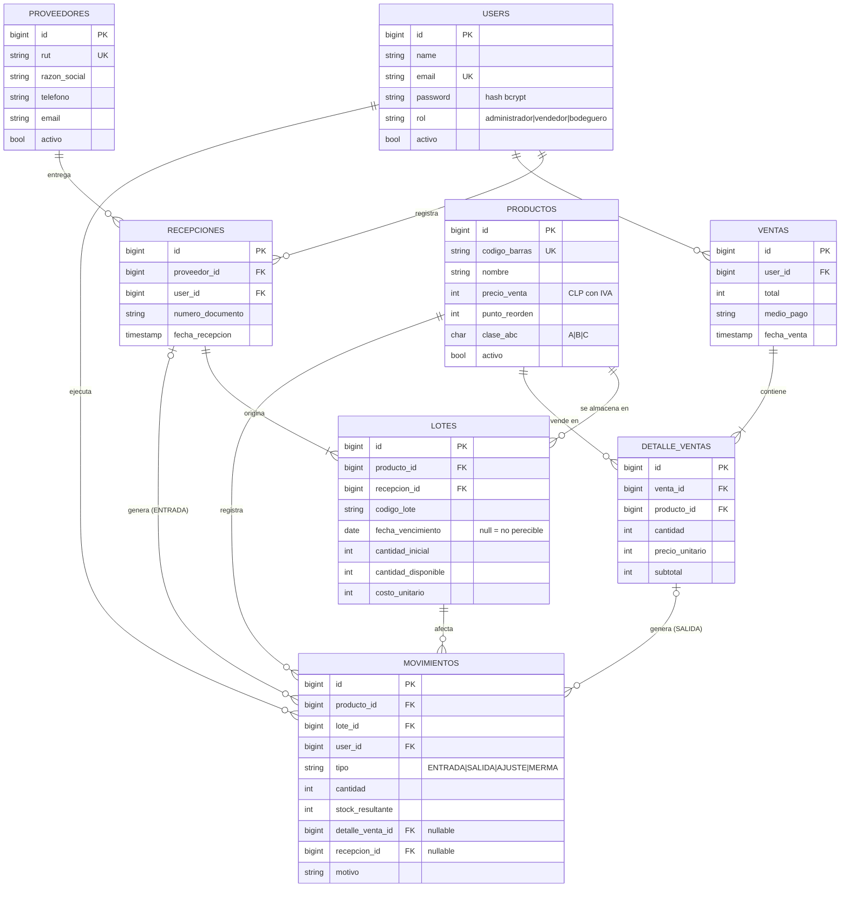

# Modelo de datos del MPV

Este modelo se construyó siguiendo las pautas del apunte de modelado de datos (Pinto, 2022):

- **Entidades** con un identificador único (clave primaria).
- **Asociaciones** 1:N.
- Las relaciones **M:N se resuelven con una entidad de intersección**.
- La **integridad referencial** se aplica mediante claves foráneas.

## Diagrama entidad-relación

## Decisiones de diseño

1. **El stock no se guarda en `productos`.** Se calcula como la suma de `lotes.cantidad_disponible`. Con una sola fuente de verdad, el stock teórico no puede desalinearse de los lotes (causa C5, control K1).
2. **`MOVIMIENTOS` es la entidad de intersección entre `DETALLE_VENTAS` y `LOTES`.** Una línea de venta puede consumir varios lotes (por ejemplo, 6 unidades: 4 del lote que vence antes y 2 del siguiente), y un lote abastece muchas ventas. Es la misma técnica del apunte para transformar una relación M:N en dos 1:N. Además, cada fila de la tabla sirve como registro de auditoría (K8).
3. **Integridad referencial con `RESTRICT`.** No se puede borrar un producto, proveedor o usuario que tenga historia; en su lugar se desactiva (`activo = false`). Así la bitácora nunca queda con referencias huérfanas.
4. **El precio se copia a `detalle_ventas.precio_unitario`.** Si el precio del producto cambia después, el historial de ventas no se altera.
5. **Los montos se guardan como enteros en CLP**, porque el peso chileno no usa decimales. Esto evita errores de redondeo.
6. **El orden de salida de los lotes es FEFO** (*first expired, first out*), una variante del criterio FIFO: sale primero el lote que vence antes y, a igual vencimiento, el que ingresó primero. Es el orden recomendado para perecibles (Decreto 977, art. 106).

## Diccionario de datos (resumen)

| Tabla | Campo | Tipo | Restricción | Descripción |
|-------|-------|------|-------------|-------------|
| productos | codigo_barras | varchar(32) | UNIQUE, NOT NULL | Código EAN leído por el escáner |
| productos | precio_venta | int unsigned | > 0 | Precio con IVA incluido (Ley 19.496) |
| productos | punto_reorden | int unsigned | ≥ 0 | Umbral de la alerta K3 |
| productos | clase_abc | char(1) | A, B o C | Prioridad de control |
| lotes | fecha_vencimiento | date | NULL permitido | NULL indica un producto no perecible |
| lotes | cantidad_disponible | int unsigned | ≥ 0 | Saldo del lote; la suma de todos los lotes es el stock |
| movimientos | tipo | varchar(10) | ENTRADA, SALIDA, AJUSTE o MERMA | Naturaleza del movimiento |
| movimientos | stock_resultante | int unsigned | NOT NULL | Stock total del producto después del movimiento |
| users | rol | varchar(20) | administrador, vendedor o bodeguero | Permisos (K8) |

## Extensiones previstas después del MPV

- **HU11:** `ordenes_compra` y `detalle_ordenes_compra`.
- **HU13:** registro de mermas, que usa `movimientos` con `tipo = MERMA` y `costo_unitario` del lote.
- **HU14:** `conteos` y `detalle_conteos`.

El modelo del MPV no requiere cambios para soportarlas; solo se agregan tablas.
