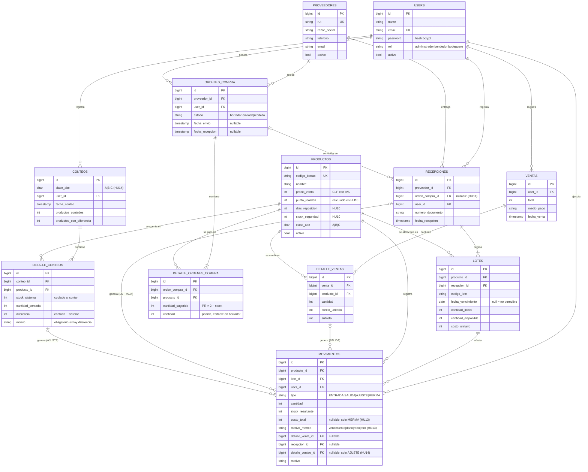

# Modelo de datos del MPV

Este modelo se construyó siguiendo las pautas del apunte de modelado de datos (Pinto, 2022):

- **Entidades** con un identificador único (clave primaria).
- **Asociaciones** 1:N.
- Las relaciones **M:N se resuelven con una entidad de intersección**.
- La **integridad referencial** se aplica mediante claves foráneas.

## Diagrama entidad-relación

## Decisiones de diseño

1. **El stock no se guarda en `productos`.** Se calcula como la suma de `lotes.cantidad_disponible`. Con una sola fuente de verdad, el stock teórico no puede desalinearse de los lotes (causa C5, control K1).
2. **`MOVIMIENTOS` es la entidad de intersección entre `DETALLE_VENTAS` y `LOTES`.** Una línea de venta puede consumir varios lotes (por ejemplo, 6 unidades: 4 del lote que vence antes y 2 del siguiente), y un lote abastece muchas ventas. Es la misma técnica del apunte para transformar una relación M:N en dos 1:N. Además, cada fila de la tabla sirve como registro de auditoría (K8).
3. **Integridad referencial con `RESTRICT`.** No se puede borrar un producto, proveedor o usuario que tenga historia; en su lugar se desactiva (`activo = false`). Así la bitácora nunca queda con referencias huérfanas.
4. **El precio se copia a `detalle_ventas.precio_unitario`.** Si el precio del producto cambia después, el historial de ventas no se altera.
5. **Los montos se guardan como enteros en CLP**, porque el peso chileno no usa decimales. Esto evita errores de redondeo.
6. **El orden de salida de los lotes es FEFO** (*first expired, first out*), una variante del criterio FIFO: sale primero el lote que vence antes y, a igual vencimiento, el que ingresó primero. Es el orden recomendado para perecibles (Decreto 977, art. 106).

## Diccionario de datos (resumen)

| Tabla | Campo | Tipo | Restricción | Descripción |
|-------|-------|------|-------------|-------------|
| productos | codigo_barras | varchar(32) | UNIQUE, NOT NULL | Código EAN leído por el escáner |
| productos | precio_venta | int unsigned | > 0 | Precio con IVA incluido (Ley 19.496) |
| productos | punto_reorden | int unsigned | ≥ 0 | Umbral de la alerta K3 |
| productos | dias_reposicion | smallint unsigned | ≥ 1, por defecto 3 | Días que tarda el proveedor en reponer (HU10) |
| productos | stock_seguridad | int unsigned | ≥ 0, por defecto 0 | Unidades extra ante atrasos o alzas de demanda (HU10) |
| productos | clase_abc | char(1) | A, B o C | Prioridad de control |
| lotes | fecha_vencimiento | date | NULL permitido | NULL indica un producto no perecible |
| lotes | cantidad_disponible | int unsigned | ≥ 0 | Saldo del lote; la suma de todos los lotes es el stock |
| movimientos | tipo | varchar(10) | ENTRADA, SALIDA, AJUSTE o MERMA | Naturaleza del movimiento |
| movimientos | stock_resultante | int unsigned | NOT NULL | Stock total del producto después del movimiento |
| movimientos | costo_total | int unsigned | NULL permitido | Solo en MERMA: cantidad × costo unitario del lote, copiado al registrar (HU13) |
| movimientos | motivo_merma | varchar(20) | vencimiento, dano, robo u otro; NULL si no es merma | Causa de la merma, base del indicador M3 (HU13, HU15) |
| proveedores | rut | varchar(12) | UNIQUE, NOT NULL | RUT con dígito verificador válido (módulo 11), guardado normalizado como `76.111.111-6` (HU09) |
| ordenes_compra | estado | varchar(10) | borrador, enviada o recibida | Ciclo de vida de la OC (HU11) |
| detalle_ordenes_compra | cantidad_sugerida | int unsigned | ≥ 1 | Punto de reorden × 2 − stock al generar la OC; se conserva aunque se edite la cantidad (HU11) |
| detalle_ordenes_compra | cantidad | int unsigned | ≥ 1; UNIQUE (orden_compra_id, producto_id) | Cantidad pedida al proveedor (HU11) |
| recepciones | orden_compra_id | bigint | FK RESTRICT, NULL permitido | OC enviada contra la que se recibió la mercadería (HU11) |
| conteos | clase_abc | char(1) | A, B o C | Clase contada; define la frecuencia: A cada 7 días, B cada 14 y C cada 30 (HU14) |
| detalle_conteos | stock_sistema | int unsigned | NOT NULL | Stock según los lotes al momento del conteo; se copia para que el historial no cambie (HU14) |
| detalle_conteos | diferencia | int (con signo) | UNIQUE (conteo_id, producto_id) | Contado − sistema: negativa = faltante, positiva = sobrante (HU14) |
| movimientos | detalle_conteo_id | bigint | FK RESTRICT, NULL permitido | Línea del conteo que originó el AJUSTE (HU14) |
| users | rol | varchar(20) | administrador, vendedor o bodeguero | Permisos (K8) |

## Extensiones previstas después del MPV

Todas las extensiones previstas ya se implementaron (ver abajo).

**Implementado (HU13):** las mermas se registran en `movimientos` con `tipo = MERMA`. La migración `2026_10_23_000001` agrega `costo_total` (se copia al registrar, igual que el precio en `detalle_ventas`, para que el historial no cambie) y `motivo_merma`, con un índice `(tipo, motivo_merma)` para el indicador de merma por vencimiento.

**Implementado (HU10):** la migración `2026_10_24_000001` agrega `productos.dias_reposicion` y `productos.stock_seguridad`. El punto de reorden se recalcula como `ceil(ventas de 28 días × días de reposición ÷ 28) + stock de seguridad`, solo para los productos con ventas en el período; el resultado se guarda en `punto_reorden` porque es un parámetro (se ajusta una vez al día), no un saldo como el stock.

**Implementado (HU11):** la migración `2026_10_25_000001` crea `ordenes_compra` y `detalle_ordenes_compra` (entidad de intersección M:N entre órdenes y productos) y agrega `recepciones.orden_compra_id`. El proveedor sugerido es el de la recepción más reciente del producto, por lo que no se necesita una tabla producto-proveedor. Las diferencias de cantidad no se guardan: se calculan comparando `detalle_ordenes_compra.cantidad` con la suma de `lotes.cantidad_inicial` de las recepciones asociadas.

**Implementado (HU14):** la migración `2026_10_26_000001` crea `conteos` y `detalle_conteos` (entidad de intersección M:N entre conteos y productos) y agrega `movimientos.detalle_conteo_id`. La programación (A semanal, B quincenal, C mensual) no se guarda: se calcula desde la fecha del último conteo de cada clase. Cada diferencia genera movimientos AJUSTE: el faltante se descuenta en orden FEFO (como una venta) y el sobrante se suma al lote más reciente; el signo del ajuste se lee desde `detalle_conteos.diferencia`. La exactitud es 1 − productos con diferencia ÷ productos contados.

## Imágenes

- [Diagrama ER compacto](img/modelo_er.png)
- [Diagrama ER detallado](img/modelo_er_detallado.png)
- [Diagrama de casos de uso](img/casos_uso.png)
- [Mockups](img/mockups/): 14 pantallas, 9 del MPV y 5 de los incrementos siguientes
